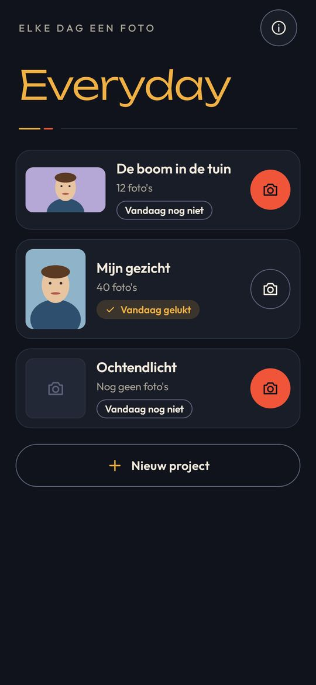
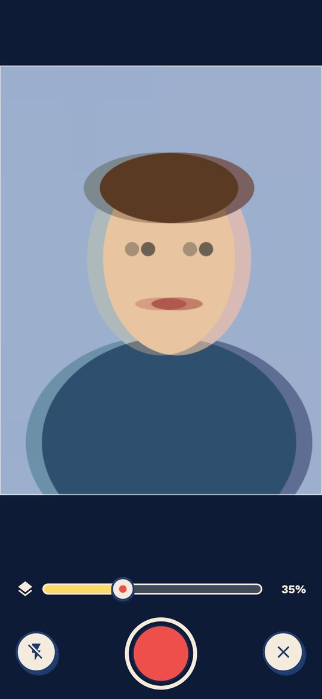
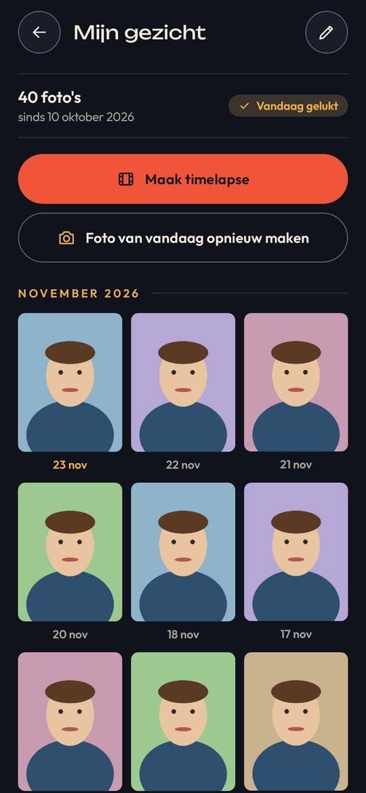
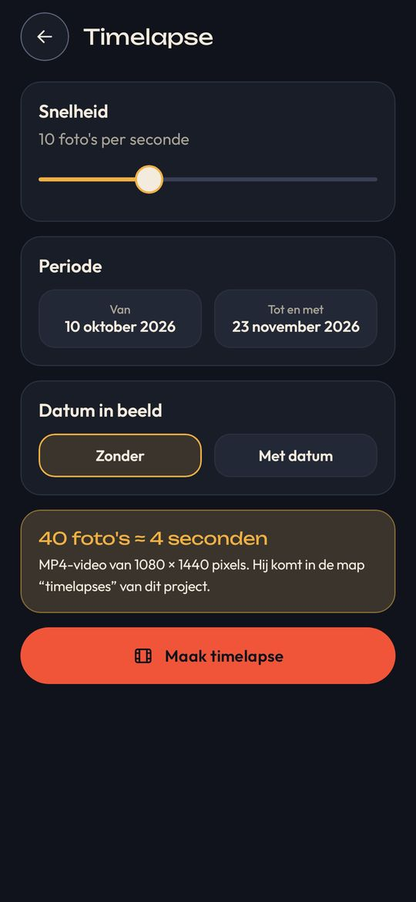

# Dagelijks

Een privé Android-app voor een dagelijkse foto-timelapse, in de geest van "Everyday" van
Noah Kalina. Je maakt elke dag een foto van hetzelfde onderwerp. De foto van de vorige keer
ligt half doorzichtig over het camerabeeld, zodat je je precies hetzelfde kunt uitlijnen.
Later maak je er op je telefoon een timelapse van.

De app is voor één persoon en één telefoon. Hij komt niet in de Play Store; je zet hem met
een usb-kabel op je eigen toestel.

**Zelf installeren? Lees [HANDLEIDING.md](HANDLEIDING.md).** Wat je daarna kunt nalopen staat
in [TESTLIJST.md](TESTLIJST.md).

## Zo ziet het eruit

<p>
  
  
  
  
</p>

De plaatjes in `docs/schermafbeeldingen` worden door de tests zelf gemaakt, met voorbeeldfoto's.

## Wat de app doet

- **Projecten** naast elkaar, bijvoorbeeld "Mijn gezicht" (selfiecamera) en "De boom in de
  tuin" (achtercamera). Per project kies je de camera en de beeldverhouding: 9:16, 3:4, 1:1
  of 16:9. Na de eerste foto ligt de beeldverhouding vast.
- **Camera met overlay.** De meest recente eerdere foto ligt over het live beeld. Met een
  schuifregelaar stel je in hoe sterk; de app onthoudt dat per project. Bij de voorcamera
  wordt de overlay gespiegeld, omdat het live beeld daar gespiegeld is en de opgeslagen foto niet.
- **Eén foto per dag.** Maak je er op dezelfde dag nog een, dan vraagt de app eerst of de
  foto van vandaag vervangen mag worden. Een gemiste dag wordt gewoon overgeslagen.
- **Afdrukken** met de grote knop of met de volumeknoppen, dus ook met een bluetooth-selfieknop.
- **Flitser** staat altijd uit als je de camera opent. Aanzetten geldt alleen voor dat ene bezoek.
- **Galerij** per project: alle foto's op datum, bekijken, verwijderen of vervangen, altijd na bevestiging.
- **Timelapse** als MP4 (H.264), volledig op het toestel: 1 tot 30 foto's per seconde, een
  optionele periode, 1080 pixels aan de korte kant, optioneel met de datum in beeld.

## Privacy

De app praat met niets en niemand.

| Belofte | Hoe het is geregeld |
|---|---|
| Geen internet | Het manifest vraagt alleen `CAMERA`. Netwerk-, locatie-, opslag- en meldingspermissies worden met `tools:node="remove"` geweerd, welke library ze ook meebrengt. |
| Aantoonbaar | Elke build controleert het samengevoegde manifest (taak `controleerPrivacy…`) en stopt bij een onverwachte permissie. `scripts/controleer-privacy.sh` controleert daarnaast de APK zelf met `aapt2 dump permissions`. |
| Niets naar de cloud | `allowBackup="false"`, plus `dataExtractionRules` en `fullBackupContent` die alles uitsluiten, ook bij het overzetten naar een nieuwe telefoon. |
| Geen meekijkers | Geen analytics, crashrapportage, advertenties, accounts of Firebase. Geen WebView. Niets wordt tijdens gebruik gedownload; ook de emoji-font-download van AndroidX is uitgezet. |
| Geen locatie in foto's | Elke foto wordt opnieuw gecodeerd. Alleen datum, tijd en "rechtop" komen in de EXIF. |
| Niet in je galerij | De hoofdmap bevat een `.nomedia`-bestand, zodat de galerij en Google Foto's hem overslaan en er niets wordt gesynchroniseerd. |

De enige uitzondering op "alleen `CAMERA`" is een interne permissie die AndroidX zelf
toevoegt (`…DYNAMIC_RECEIVER_NOT_EXPORTED_PERMISSION`). Die geeft nergens toegang toe en kan
alleen door de app zelf worden gebruikt.

## Waar je foto's staan

Bij de eerste start kies je een map op je telefoon, bijvoorbeeld `Documenten`. De app maakt
daarin de map `Dagelijks`:

```
Dagelijks/
  .nomedia
  Mijn gezicht/
    project.json          instellingen: camera, beeldverhouding, overlay, snelheid
    2026-11-23.jpg
    2026-11-24.jpg
    timelapses/
      Mijn gezicht_2026-11-23_tot_2027-11-23.mp4
```

De map is de enige bron van waarheid; er is geen database. Wat in de map staat, is wat de
app toont. Daardoor:

- blijven je foto's staan als je de app verwijdert;
- komen alle projecten en instellingen terug als je na een herinstallatie dezelfde map kiest;
- doen foto's die je zelf met de naam `JJJJ-MM-DD.jpg` in een projectmap zet gewoon mee.

De toegang tot de map loopt via het Storage Access Framework van Android. De app vraagt
dus geen brede opslagpermissie, en de mappenkiezer biedt alleen de opslag van de telefoon
zelf aan, geen clouddiensten.

## Bouwen

Je hebt Android Studio nodig (voor de JDK en de Android SDK). Daarna:

```bash
./gradlew installRelease
```

Op Windows doet `installeer-op-telefoon.bat` hetzelfde met een dubbelklik.

**Ondertekening.** De eerste build maakt een vaste sleutel aan in
`<thuismap>/Dagelijks-sleutel` (`dagelijks-sleutel.p12` en `sleutel.properties`). Debug en
release gebruiken allebei die sleutel, zodat elke nieuwe versie over de vorige heen kan.
De sleutel en het wachtwoord staan buiten deze repository. Maak er een reservekopie van.
Een andere plek kan met de Gradle-eigenschap `dagelijks.sleutelmap`.

Versies: minSdk 26 (Android 8), targetSdk 37, AGP 9.5, Kotlin 2.4, Compose BOM 2026.11, CameraX 1.7.

## Testen

```bash
./gradlew testDebugUnitTest            # logica, fotoverwerking met echte pixels, alle schermen
./gradlew connectedDebugAndroidTest    # op een aangesloten telefoon of emulator
```

- **Unittests** dekken datums en bestandsnamen, het kiezen van de vorige foto, "vandaag al
  gemaakt?", bijsnijden en spiegelen, `project.json`, de opslag op schijf en het
  rekenwerk van de timelapse. Een deel draait op een nagebootst Android (Robolectric) en
  controleert echte pixels: de foto staat rechtop, is niet gespiegeld en bevat geen locatie.
- **Tests op een emulator** gebruiken de echte camera, de echte mappenkiezer en de echte
  video-encoder. Ze controleren onder meer dat de overlay samenvalt met het live beeld en
  dat de foto's buiten de galerij blijven.

De workflow in `.github/workflows/bouw.yml` draait dit alles bij elke push.

## Keuzes

| Keuze | Waarom |
|---|---|
| `MediaCodec` + `MediaMuxer` in plaats van Media3 Transformer | Transformer brengt ExoPlayer mee, met `ACCESS_NETWORK_STATE`, `WAKE_LOCK` en netwerkcode. |
| Geen WorkManager of foreground service | WorkManager vraagt vier extra permissies aan, waaronder `ACCESS_NETWORK_STATE`. Het renderen draait op een eigen thread en het scherm blijft aan. |
| `SharedPreferences` in plaats van DataStore | DataStore brengt Okio mee. De app onthoudt alleen welke map je koos. |
| Eigen afbeeldingslader in plaats van Coil of Glide | Die vragen allebei `INTERNET` aan. |
| Eigen navigatie in plaats van een navigatielibrary | Acht schermen; een lijstje volstaat. |
| Altijd een eigen map `Dagelijks` | Android negeert en verwijdert `.nomedia` in standaardmappen zoals Documenten. |
| Foto opnieuw coderen, rechtop | Zo toont elk programma hem goed, ook als het EXIF negeert, en kan er geen metadata van de camera meekomen. |
| 16:9 fotografeer je met de telefoon op zijn kant | Zo wordt de volle breedte van de sensor gebruikt. Welke kant boven ligt, maakt niet uit. |
| Vaste sleutel voor debug én release, zelfde app-id | Elke build kan over elke andere heen. |

## Licenties

De app bundelt drie lettertypen onder de SIL Open Font License 1.1: Shrikhand, Pacifico en
Work Sans. De licentieteksten staan in [`licenties/`](licenties). De pictogrammen zijn
Material Design icons (Apache-licentie 2.0).
